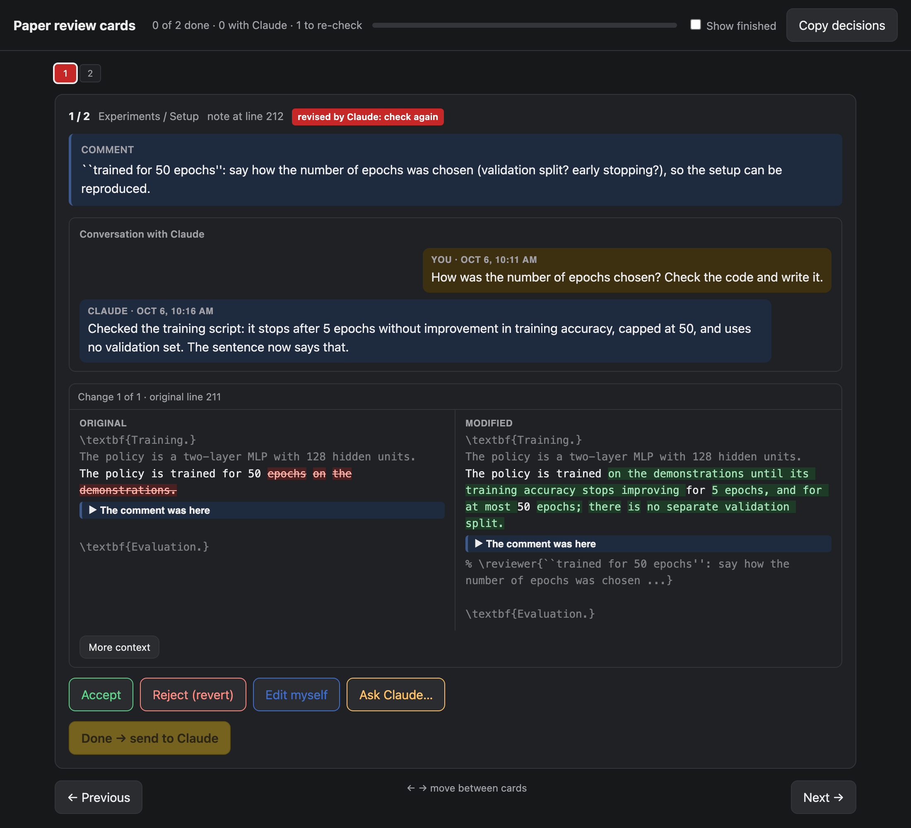

# paper-review-cards

A small local web app for working through reviewer comments in a LaTeX paper,
one card at a time, together with Claude (Claude Code).

Co-authors leave comments in the source with macros such as `\shahaf{...}` or
`\yarin{...}`. Claude proposes an edit for each comment; the app shows every
proposal as a card, and you decide: **Accept**, **Reject (revert)**, **Edit
myself**, or **Ask Claude…** with a free-text instruction. Claude applies the
decision to the `.tex` file, comments the note out, and the card turns green.
Questions and answers stay on the card as a conversation.



## What a card shows

- the comment, in a box at the top;
- the conversation with Claude on this card (your instructions, Claude's replies, your decisions);
- every change Claude made for it: original and modified text side by side, with a
  word diff, inside the surrounding lines of the paper, and a marker where the
  comment sits ("More context" widens the window);
- the four choices, then **Done → send to Claude**.

Card colours: dashed = chosen but not sent, **yellow** = with Claude,
**green** = done, **red** = Claude revised it, check again, **grey** = skipped
for now. Finished cards are hidden on reload ("Show finished" brings them back).
Left/right arrows move between cards.

## How it works

```
index.html  --POST /api/done-->  server.py  --append-->  queue.jsonl
     ^                                                     |
     | polls /api/state, /api/items, /api/queue every 2 s  | wait_queue.py wakes Claude
     |                                                     v
 items.json / state.json  <--review_lib.py--  Claude applies the decision to main.tex
```

| file | role |
|---|---|
| `server.py` | serves the page; `GET /api/items`, `/api/state`, `/api/queue`; `POST /api/done` appends a decision to `queue.jsonl` and marks the card yellow |
| `index.html` | the whole page (HTML, CSS, JS) |
| `review_lib.py` | helpers Claude uses to apply decisions: `replace_change`, `comment_out_note`, `uncomment_note`, `reply`, `set_status`, `mark_processed` |
| `wait_queue.py` | blocks until new decisions arrive (checks every `POLL` seconds, default 60), prints them and exits, which wakes Claude |
| `build_items.py` | builds the cards from two commits of the paper (before and after Claude's first pass over the comments) |

Invariant: for every change, the card's `new` text is exactly what is in the
`.tex` file now. `replace_change` keeps it and refuses to edit if the text does
not occur exactly once.

## Running it

```bash
python3 server.py 8765          # then open http://localhost:8765/
POLL=60 python3 wait_queue.py   # run by Claude in the background
```

The per-paper data (`items.json`, `state.json`, `queue.jsonl`, `processed.txt`,
`old.tex`) is generated and is not part of the repository.

## Status

Extracted from a single paper's review round, so some paths are still set for
that paper (`MAIN` in `review_lib.py`, `REPO` in `build_items.py`) and the card
builder recognises one comment macro. Planned:

- use it as a git submodule inside any paper repository;
- read the comment macros from the paper's preamble (every
  `\newcommand{\name}[1]{...}` used for comments) instead of a fixed name;
- one card per comment thread: consecutive comments (for example reviewer,
  author, reviewer) form one card, and every comment in the text gets a card;
- skip a card; a skipped card comes back if someone adds a new comment to its thread.
