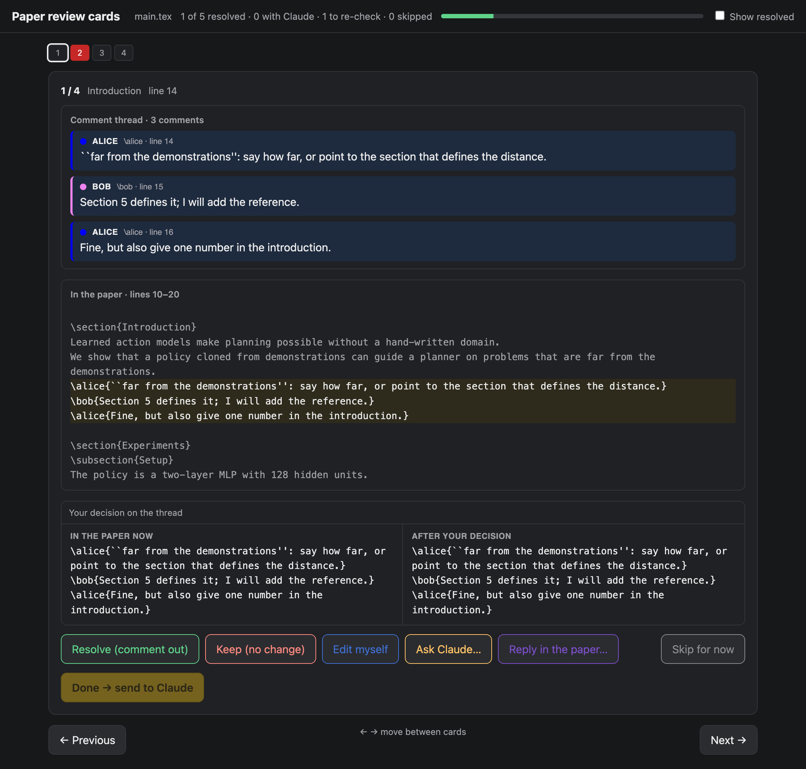
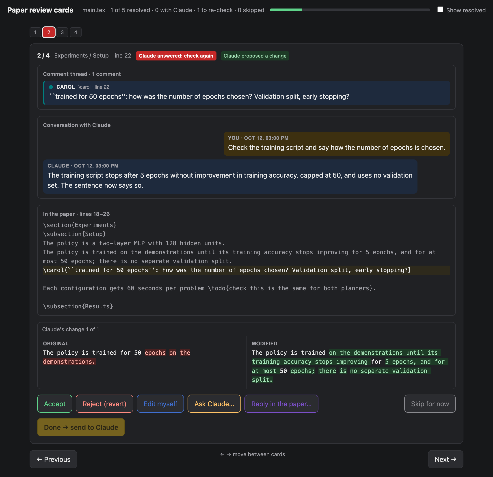

# paper-review-cards

Work through the comments in a LaTeX paper one card at a time, together with
Claude (Claude Code).

Co-authors leave notes in the source with their own macros, such as
`\alice{...}` or `\todo{...}`. paper-review-cards finds every such macro in the
preamble, finds every comment in the text, and groups comments that follow each
other into **threads** (Alice asks, Bob answers, Alice follows up: one card).
For each card you can ask Claude to act or answer, reply in the paper as
yourself, resolve the thread, or skip it for now. When Claude proposes an edit,
the card shows it as a diff to accept, reject or edit.





## How comments are found

- **Macros:** every one-argument command in the preamble whose body shows its
  argument as a note, e.g.
  `\newcommand{\alice}[1]{\ifaddcomments{\textcolor{blue}{[Alice: #1]}}\fi}`
  (it uses `#1` with `\textcolor`, `\color`, `\marginpar`, `\todo`, ...).
  The label (`Alice`) and colour (`blue`) are read from the definition.
  Formatting macros such as `\newcommand{\emphx}[1]{\textbf{#1}}` are not notes.
- **Comments:** every use of those macros after `\begin{document}`, on its own
  lines or inline, spanning lines or not, live or commented out with `%`.
- **Threads:** comments separated only by whitespace and `%` are one thread.
  A thread with a live comment is open; one whose comments are all commented
  out is resolved (hidden unless "Show resolved").
- **Skip:** a skipped card stays out of the way until its thread changes. If
  anyone adds a comment to it (or edits one), it comes back, marked
  "skipped, but the thread has a new comment".

The paper is rescanned on every request, so the page follows edits to the
`.tex` as they happen. `python3 scan.py main.tex` prints the macros and threads.

## On a card

- the thread, each comment with its author and line;
- the conversation with Claude on this card;
- the thread in the paper, with a few lines around it;
- what your decision does: Claude's changes as an original/modified word diff,
  or, when there are none yet, the thread itself ("In the paper now" vs "After
  your decision").

Choices: with Claude's changes, **Accept** / **Reject (revert)** / **Edit
myself**; without them, **Resolve (comment out)** / **Keep (no change)** /
**Edit myself** (rewrite the thread's lines). On every card: **Ask Claude…**,
**Reply in the paper…** (adds your own `\macro{...}` under the thread; the card
then waits for the others' answer) and **Skip for now**. Kept and skipped cards
come back when someone adds to their thread. **Done → send to Claude** sends
the choice. Cards Claude marked as needing a check outside the text (a plot, an
experiment, data, code) are listed first.

Colours: dashed = chosen, not sent; **yellow** = with Claude; **red** = Claude
answered, check again (or a skipped thread changed); **grey** = skipped;
**green** = resolved. Left/right arrows move between cards, and
`http://localhost:8765/#<card id>` opens a card directly.

## Setup

Add it to the paper's repository as a submodule and start the server from there:

```bash
git submodule add https://github.com/yarinbnyamin/paper-review-cards
python3 paper-review-cards/server.py --tex main.tex      # http://localhost:8765/
```

Decisions and state are kept in `.review-cards/` next to the `.tex`; that
directory ignores itself in git. Claude handles the decisions: it runs
`wait_queue.py` in the background, which wakes it when you click Done, and
applies them with `review_lib.py`. `CLAUDE.md` is its handbook; point Claude to it.

### Recommended: one subagent per suggested edit

Use it with several subagents, one per edit suggestion: give each card's work
(drafting a proposal, or answering an "Ask Claude") to its own subagent, run
them in parallel, and let the main Claude session only verify their results and
apply them. Each subagent reads the paper and writes its suggestion to a file;
only the main session edits the `.tex`, so parallel agents never overwrite each
other. A whole round of cards then takes about as long as the slowest card.
`CLAUDE.md` describes the exact procedure ("Work per card goes to subagents"
and "Proposing in advance").

Python 3.8+ only, no dependencies.

## Files

| file | role |
|---|---|
| `scan.py` | finds the comment macros, the comments and the threads |
| `server.py` | serves the page; `/api/items`, `/api/meta`, `/api/state`, `/api/queue`; `POST /api/done`, `/api/skip`, `/api/unskip` |
| `index.html` | the page |
| `review_lib.py` | what Claude uses to act on a card: `propose`, `replace_change`, `reject_all`, `comment_out_thread`, `add_comment`, `reply`, `set_status` |
| `wait_queue.py` | waits for new decisions (checks every `POLL` seconds, default 60) |
| `examples/demo.tex` | a small paper with every kind of thread |
| `examples/screenshots.sh` | rebuilds the two README screenshots from the demo (needs Chrome and Pillow) |
| `tests/` | `python3 -m unittest discover -s tests` |
